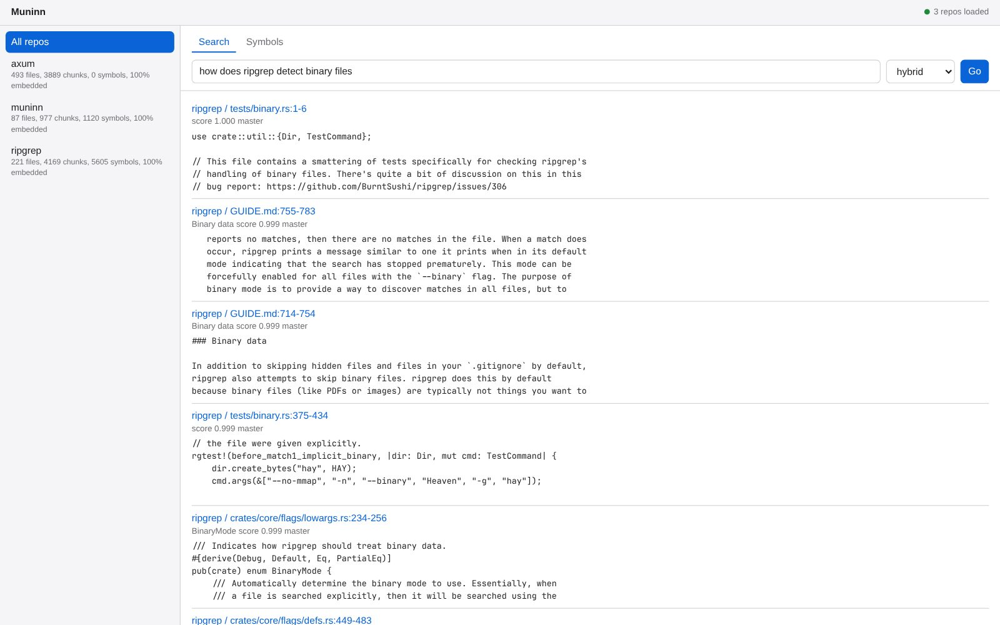

# Muninn

[](https://github.com/olibuijr/muninn/actions/workflows/ci.yml)
[](CHANGELOG.md)
[](LICENSE)

**A self-hosted code index and shared memory for AI coding agents.**

[Website](https://muninn.olibuijr.com/) · [Install](#install) · [Use with AI agents](#use-with-ai-agents) · [Contributing](CONTRIBUTING.md)

Odin's raven Muninn ("memory") flies over the world and comes back with what it saw. This one flies
over your git repos and your agents' sessions: Claude Code, Codex and any other MCP client can
search your code by meaning, follow symbols through their callers, and recall what earlier
sessions decided, without each one re-reading the codebase from scratch.

- **Hybrid code search.** BM25 and embeddings fused by reciprocal rank, then a cross-encoder
  reranker. Chunks follow the syntax tree (functions, impls, classes), not fixed windows.
- **Symbols and call graphs.** SCIP indexes (rust-analyzer, scip-typescript) give definitions,
  references, callers and callees; `explain_symbol` answers "who calls this".
- **Instant reindex.** A git hook on each bare mirror reindexes the changed files on every push.
  `muninn-watch` overlays uncommitted edits within about a second.
- **Shared agent memory.** Facts, decisions and how-tos with scopes (global, project, agent),
  Postgres row-level security per token, near-duplicate and conflict detection, a review queue,
  supersession, an append-only audit log, and weekly consolidation. Secrets are refused.
- **Agent-native.** An MCP server with nine tools, a CLI with `--json`, a bundled agent skill and
  Claude Code / Codex hooks that inject relevant memories into each prompt.
- **Yours.** Rust services, Postgres with pgvector, and any OpenAI-compatible model server
  (llama.cpp works). Nothing leaves your network.



## How it fits together

```
 git push ──► bare mirror ──hook──► muninn-indexd :7410 ──► Postgres + pgvector
                                     │  search, symbols, files            ▲
 agents ──MCP──► muninn-mcp :7411 ───┤                                    │
        ──CLI──► muninn ─────────────┴──► muninn-memoryd :7412 ───────────┘
 browser ─────► muninn-indexweb :7415 (viewer)      embeddings / rerank ──► model server
```

| Binary | What it does |
|---|---|
| `muninn-indexd` | Indexes bare mirrors on push; `/search`, `/symbol`, `/graph`, `/file`, `/repos` |
| `muninn-memoryd` | Memory store: `/remember`, `/recall`, `/forget`, `/review`; `lifecycle` jobs |
| `muninn-mcp` | Streamable-HTTP MCP server over both, scoped per token |
| `muninn-indexweb` | Browser viewer for repos, search, symbols and files |
| `muninn-watch` | Sends uncommitted edits in named checkouts to indexd |
| `muninn-scip` | Builds SCIP symbol indexes outside indexd (big Rust workspaces need GBs) |
| `muninn` | CLI for agents and people: search, symbol, recall, remember, review, eval, hooks |

## Install

Needs x86_64 Linux with systemd, Postgres 16+ with pgvector, and an OpenAI-compatible server
for embeddings (768 dimensions, e.g. embeddinggemma-300m) and reranking (e.g. bge-reranker-v2-m3),
such as two `llama-server` processes.

```sh
curl -LO https://github.com/olibuijr/muninn/releases/latest/download/muninn-x86_64-linux.tar.gz
tar xzf muninn-x86_64-linux.tar.gz && cd muninn-x86_64-linux
cp index.env.example ~/.config/muninn/index.env   # then fill it in (mode 0600)
./install.sh                                      # binaries, systemd user units, start
```

Create the database once (as a Postgres superuser):

```sql
create user muninn password 'CHANGE_ME';
create database muninn owner muninn;
\c muninn
create extension vector;
-- after the first muninn-memoryd start has created the role:
grant muninn_app to muninn;
```

Give each agent or machine a token. `tokens.json` keeps only hashes:

```sh
tok=$(openssl rand -hex 32); echo "$tok"     # hand this to the client
printf '%s' "$tok" | sha256sum               # goes into tokens.json
```

```json
[{"sha256": "<hex>", "actor": "laptop", "projects": [],
  "scopes": ["index:read", "memory:read", "memory:write", "memory:forget"]}]
```

Enroll repos by mirroring them into `MUNINN_REPOS_DIR` and running the backfill once:

```sh
git clone --mirror https://github.com/you/api ~/.local/share/muninn/repos/api.git
~/.local/share/muninn/backfill.sh api        # installs the push hook and indexes HEAD
```

From then on every push (or `git fetch`) into the mirror reindexes the changed files.
`muninn-enroll.timer` picks up new mirrors every 15 minutes.

## Connect agents

On each machine with Claude Code or Codex, with `muninn` on PATH:

```sh
MUNINN_HOST=http://your-server MUNINN_HOOK_REPOS='~/src/api,~/src/acme-*' ./client.sh
```

It stores the token in `~/.config/muninn/token`, registers the `muninn` MCP server (Claude Code
fetches the header through `muninn mcp-header`, so the token is not written into its config),
installs the hooks and the skill, and runs `muninn doctor`.

MCP tools: `code_search`, `symbol_lookup`, `explain_symbol`, `search_all`, `read_file`,
`list_repos`, `recall`, `remember`, `forget`. A token only sees the tools its scopes allow.

## Use with AI agents

Agents use Muninn through the MCP server or the CLI with `--json`. The bundled skill
([skills/muninn/SKILL.md](skills/muninn/SKILL.md)) tells an agent when to search the index, when to
recall and what is worth remembering, and how to diagnose a broken setup with `muninn doctor`.
`client.sh` installs it for Claude Code and Codex; `muninn skill --install DIR` writes it anywhere
else, and `muninn skill` prints it.

```sh
muninn --json search "where is the webhook signature checked" -k 5
muninn --json symbol search_path --repo ripgrep
muninn --json recall "how do we cut a release" -k 3
muninn remember "Deploys need the staging tag" --type procedural --source issue:API-212
```

## CLI

```
muninn search <query> [--repo R] [--branch B] [--mode lexical|semantic|hybrid] [-k N]
muninn symbol <name> [--repo R]          muninn repos
muninn recall <query> [--scope S] [-k N] muninn remember <text> [--type T] [--scope S] ...
muninn forget <id>                       muninn review list|approve|reject|approve-all
muninn doctor                            muninn skill        muninn hook prompt|pre|post
muninn eval <cases.tsv>...               muninn expand <query>
```

Add `--json` for machine-readable output. Settings come from the environment or
`~/.config/muninn/client.env`: `MUNINN_INDEXD_URL`, `MUNINN_MEMORYD_URL`, and the token from
`MUNINN_TOKEN`, `MUNINN_TOKEN_CMD` (a command, such as a password-manager lookup) or
`~/.config/muninn/token`.

## Build from source

```sh
cargo build --release          # Rust 1.98+ (rust-toolchain.toml pins it)
cargo test --workspace         # live tests skip unless MUNINN_TEST_PG_URL is set
./deploy/install.sh            # from a checkout, builds then installs
```

Live tests (`crates/*/tests/*_live.rs`) need `MUNINN_TEST_PG_URL` pointing at a scratch
database (never your real one); memory tests also need `MUNINN_EMBED_URL` and `MUNINN_RERANK_URL`.
Retrieval quality is measured with `muninn eval`; see [scripts/eval](scripts/eval/README.md).
Operations notes are in [deploy/README.md](deploy/README.md).

## License

[MIT](LICENSE). Contributions welcome; see [CONTRIBUTING.md](CONTRIBUTING.md).
